<p align="center">
  
</p>

<p align="center">
  <a href="https://satturambowork.github.io/Minesweeper/"></a>
</p>

<p align="center">
  
  
  
  
  
</p>

---

<p align="center">
  
</p>

## ✨ Features

- 🎚️ **Three classic difficulties**: Beginner (9×9, 10 mines), Intermediate (16×16, 40 mines), Expert (30×16, 99 mines)
- 🛟 **First click is always safe**: mines are placed only *after* your first click
- 🌊 **Flood-fill reveal**: clicking an empty cell opens the whole empty region, just like the original
- 🚩 **Flagging** with right-click and a live flag counter that turns critical as you run out
- 🎯 **Chording**: click a revealed number whose flags are all placed to open every other neighbour at once, with the classic "pressed" preview while you hold the mouse
- ❌ **Wrong-flag reveal** on game over, so you can see where you went wrong
- 💥 **Particle explosion** drawn on a canvas, with sound, when you hit a mine
- ⏱️ **Timer** and **per-difficulty high scores** saved in your browser

---

## 🧠 How it works

<details open>
<summary><b>🌊 Flood fill with BFS</b></summary>

When you click a cell with no neighbouring mines, the game runs a **breadth-first search** from that cell:

1. Reveal the cell and push it onto a queue.
2. For each cell taken off the queue, look at all 8 neighbours.
3. Reveal every unrevealed, unflagged neighbour. If it is also a `0`, push it so its neighbours get opened too.
4. Stop when the queue is empty. The open region is now bordered by numbered cells.

A `visited` grid makes sure each cell is processed once, so a reveal is **O(rows × cols)** in the worst case.

</details>

<details>
<summary><b>🔢 Neighbour counts</b></summary>

After the mines are placed, every cell's number is computed once by checking its 8 neighbours with bounds checks. The board is stored as a flat array, so `(row, col)` maps to index `row × cols + col`.

</details>

<details>
<summary><b>🛟 Safe first click</b></summary>

Mines are not placed when the board is drawn. The first click records the cell, then mines are sampled into a `Set` until there are enough, skipping the clicked cell. This guarantees you never lose on move one.

</details>

<details>
<summary><b>🎯 Chording</b></summary>

Pressing on a revealed number highlights its hidden neighbours. On release, if the number of flagged neighbours equals the number on the cell, every other hidden neighbour is revealed in one go, the same shortcut expert players use in the original game.

</details>

---

## 🗂️ Project structure

```
index.html        Landing page with difficulty selection
game.html         Game page
game.js           Board setup, clicks, flags, chording, win and loss
gamelogic.js      Neighbour counts, BFS flood fill, chord press/release
explosion.js      Canvas particle explosion
time.js           Game timer
score.js          High scores in localStorage
styles/           Landing and game styles
sounds/           Explosion sound effect
```

---

## 🎮 How to play

| Action | Control |
|---|---|
| Reveal a cell | Left click |
| Place or remove a flag | Right click |
| Chord (open all other neighbours) | Click a number whose mines are all flagged |
| Restart | Restart button |

Reveal every cell that isn't a mine to win. Beat your best time to set a new high score.

---

<p align="center">
  Built by <a href="https://github.com/SATTURAMBOWORK"><b>Satvik Singh</b></a>
</p>

<p align="center">
  
</p>
